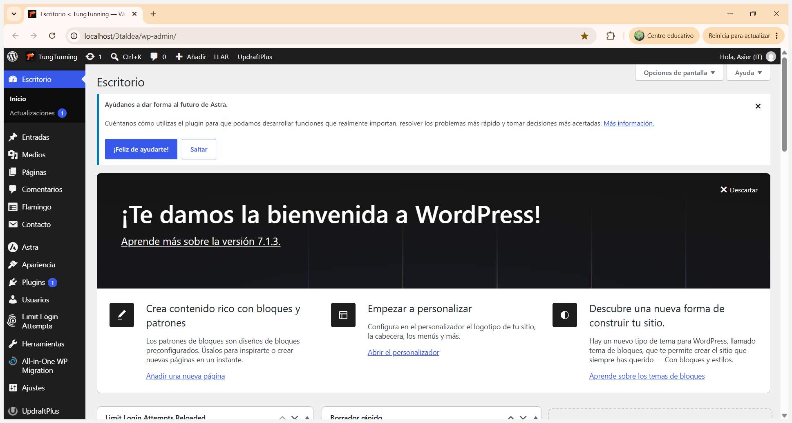
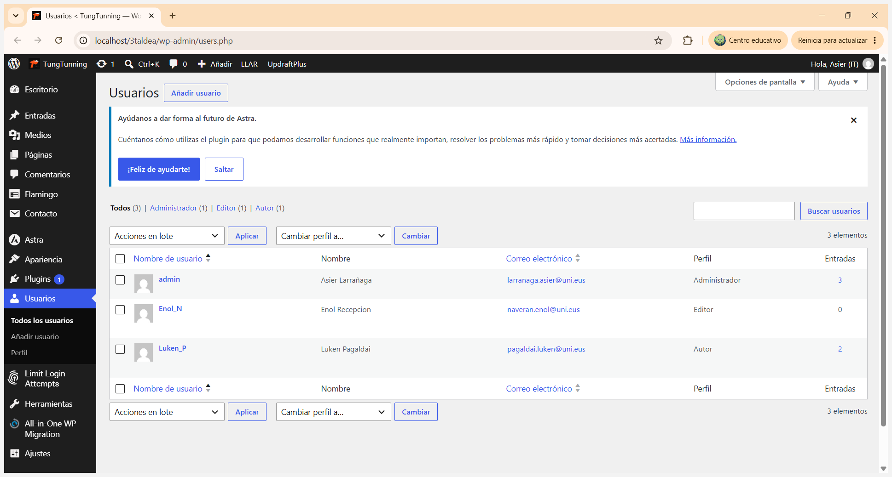
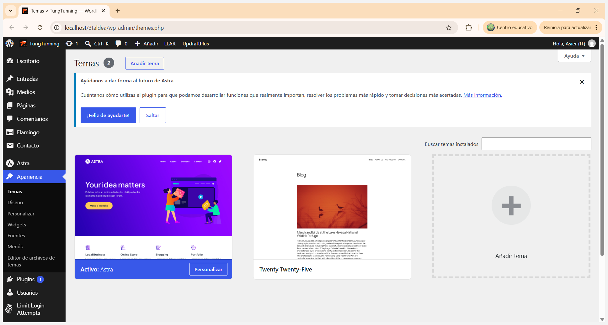
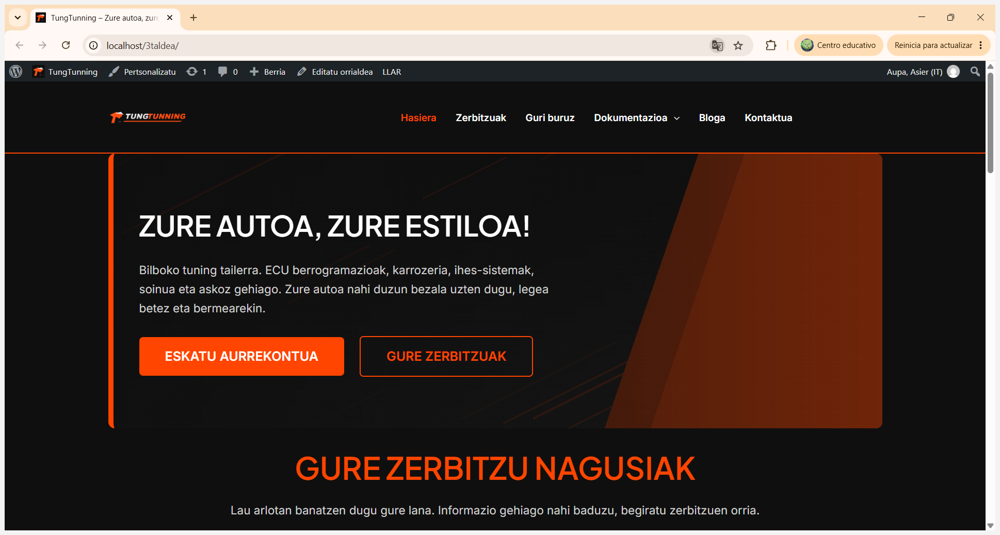
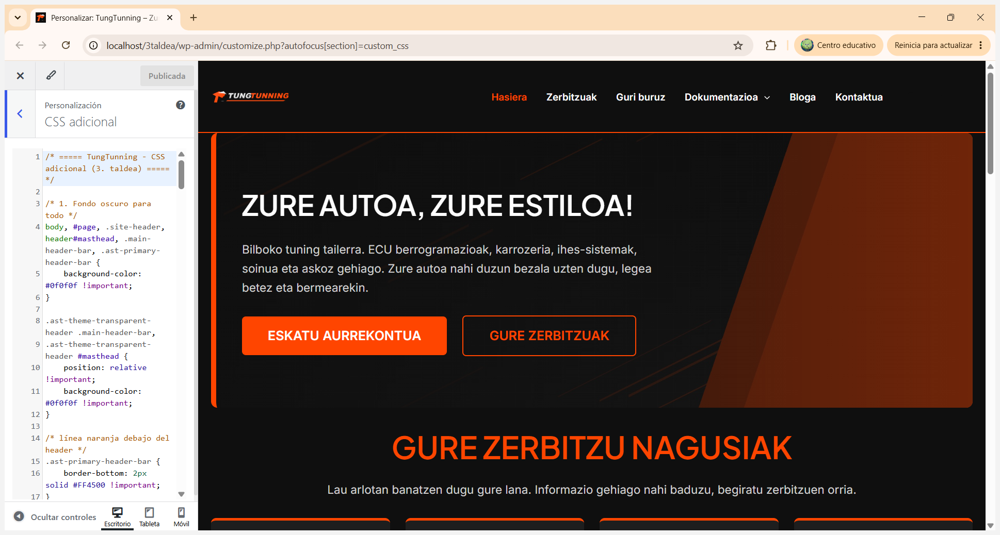
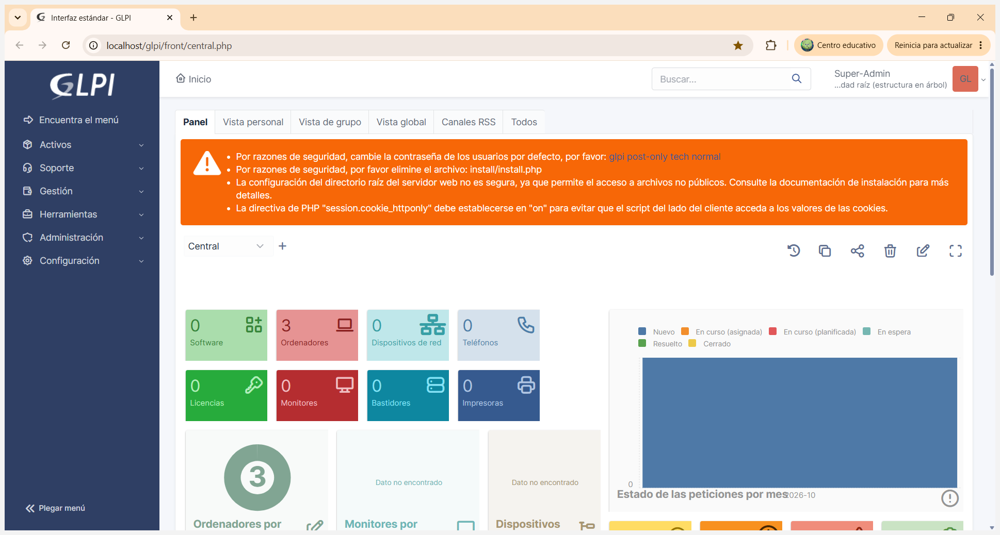
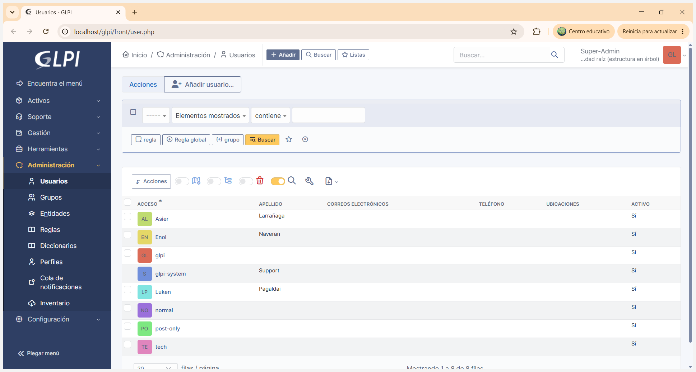
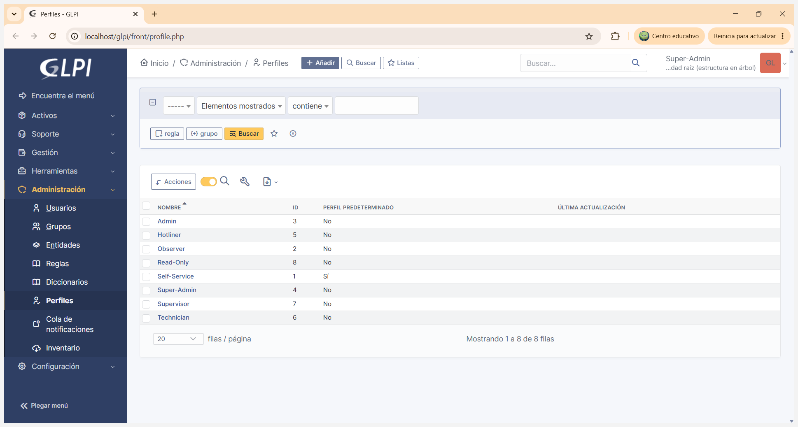
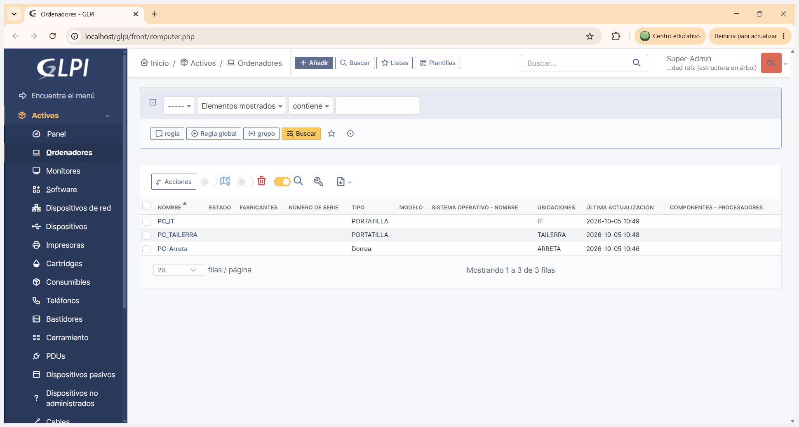
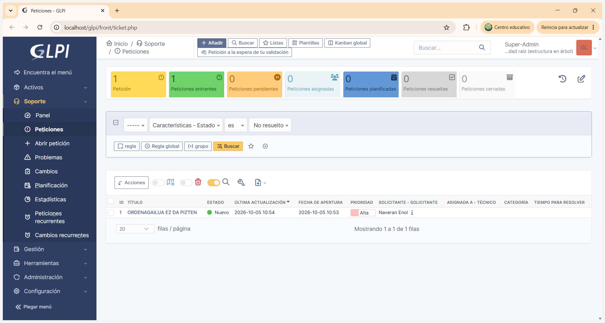

# WAE — Web Aplikazioen Ezarpena — TungTunning

> **Enpresa:** TungTunning (tuning tailerra) · **Taldea:** 3. taldea
> **Edukia:** WordPress (enpresaren web-ataria) eta GLPI (gertakari/txartel-sistema).
> **Azpiegitura:** XAMPP (Apache + MySQL/MariaDB), `localhost` web-zerbitzarian.
> **Araua:** egin, dokumentatu eta justifikatu; dokumentazioak benetako konfigurazioarekin bat etorri behar du.

---

## 1. Sarrera

TungTunning enpresak bi web-aplikazio ditu, biak web-zerbitzari berean, XAMPP ingurunean (Apache + MySQL/MariaDB):

| Aplikazioa | Funtzioa | URLa |
|---|---|---|
| **WordPress 7.1.3** | Enpresaren web-ataria (CMS) | `http://localhost/3taldea/` (admin: `/3taldea/wp-admin/`) |
| **GLPI** | Gertakarien/txartelen eta inbentarioaren kudeaketa | `http://localhost/glpi/` |

Datu-basea MySQL/MariaDB da (GLPIk `glpi_user` erabiltzailea du; ikus *Datu-baseak* dokumentua).

---

## 2. WordPress

### 2.1. Erabilera eta CMSaren funtzionalitateak

WordPress CMSa aukeratu da enpresaren weba sortzeko, edukia teknikaririk gabe eguneratu ahal izateko. Webaren erabileraren eta CMSaren funtzionalitateen arteko lotura:

| Webaren beharra | WordPressen funtzionalitatea |
|---|---|
| Tailerraren aurkezpena eta zerbitzuak (ECU, karrozeria, ihes-sistemak, soinua) | **Orriak** (*Hasiera*, *Zerbitzuak*, *Guri buruz*) |
| Berriak eta proiektuak argitaratzea | **Bloga / Sarrerak** (*Bloga* menua) |
| Bezeroen eskaerak (aurrekontua) jasotzea | **Contact Form** inprimakia (*Kontaktua*) + **Flamingo** (mezuak gordetzeko) |
| Proiektuaren dokumentazioa erakustea | *Dokumentazioa* menua (azpi-orriekin) |
| Segurtasuna eta babeskopiak | **Limit Login Attempts** (saio-hasiera saiakerak mugatu) eta **UpdraftPlus** (babeskopiak) |
| Migrazioa | **All-in-One WP Migration** |

### 2.2. Instalazioaren parametroak

| Parametroa | Balioa |
|---|---|
| Web-zerbitzaria | Apache (XAMPP) |
| Instalazio-karpeta | `C:\xampp\htdocs\3taldea` |
| Web-helbidea | `http://localhost/3taldea/` |
| Administrazio-URLa | `http://localhost/3taldea/wp-admin/` |
| Datu-basea | MySQL/MariaDB (XAMPP), WordPressentzako datu-base propioa |
| Bertsioa | WordPress 7.1.3 |
| Gunearen izena | TungTunning — *Zure autoa, zure estiloa — Bilboko tuning tailerra* |

<!-- Argazkia: WordPressen wp-admin panela (Escritorio), localhost/3taldea/wp-admin barran. -->



### 2.3. Erabiltzaileak eta pribilegioak

Hiru erabiltzaile sortu dira, bakoitza rol desberdin batekin, saileko lanaren arabera (pribilegio minimoen printzipioa):

| Erabiltzailea | Izena | Rola | Pribilegioak |
|---|---|---|---|
| `admin` | Asier Larrañaga (IT) | **Administratzailea** | Kontrol osoa: pluginak, itxura, erabiltzaileak, ezarpenak |
| `Enol_N` | Enol (Harrera) | **Editorea** | Edukia (orriak/sarrerak) sortu, editatu eta argitaratu, besteenak barne; ez du konfiguraziorik aldatzen |
| `Luken_P` | Luken Pagaldai | **Egilea** (*Autor*) | Bere sarrerak soilik idatzi eta argitaratu |

**Justifikazioa:** IT sailak bakarrik du administrazio-baimena; harrerak webeko edukia eguneratzen du (editorea) baina ezin ditu pluginak edo itxura aldatu; tailerreko langileak bere lanen berriak argitaratu ditzake (egilea), besteen edukia ukitu gabe.

<!-- Argazkia: erabiltzaileen zerrenda, bakoitza bere rolarekin (Administrador, Editor, Autor). -->



### 2.4. Txantiloiak (plantillak)

Bi txantiloi probatu dira:

| Txantiloia | Ezaugarriak | Emaitza |
|---|---|---|
| **Twenty Twenty-Five** | WordPressen lehenetsitako bloke-txantiloia, blog estilokoa | Sinpleegia enpresa-web baterako |
| **Astra** ✅ | Arina, erantzukorra (*responsive*), pertsonalizagarria (goiburua, koloreak, tipografia), Elementor/Gutenbergekin bateragarria | **Aukeratua** |

**Aukeraketaren justifikazioa:** Astra aukeratu da azkarra eta erantzukorra delako (mugikorrean ondo ikusten da), goiburua eta menua pertsonalizatzeko aukera asko dituelako eta CSS gehigarriarekin erraz egokitzen delako tuning-tailer baten irudira (ilun + laranja).

<!-- Argazkia: instalatutako txantiloiak (Astra aktibo, Twenty Twenty-Five probatua). -->


<!-- Argazkia: hautatutako azken txantiloia (Astra) aplikatuta, webaren hasiera-orria. -->



### 2.5. Diseinua eta CSS pertsonalizazioa

Diseinua tuning-tailer baten irudiarekin bat egiteko pentsatu da: **atzealde iluna** (`#0f0f0f`) eta **laranja** (`#FF4500`) kolore nagusi gisa, logo propioa (*TUNGTUNNING*) eta menu argia (*Hasiera, Zerbitzuak, Guri buruz, Dokumentazioa, Bloga, Kontaktua*).

Aldaketak **Itxura › Pertsonalizatu › CSS gehigarria** atalean egin dira. Adibidez:

```css
/* ===== TungTunning - CSS adicional (3. taldea) ===== */

/* 1. Atzealde iluna osorako */
body, #page, .site-header, header#masthead, .main-header-bar, .ast-primary-header-bar {
    background-color: #0f0f0f !important;
}

.ast-theme-transparent-header .main-header-bar,
.ast-theme-transparent-header #masthead {
    position: relative !important;
    background-color: #0f0f0f !important;
}

/* Lerro laranja goiburuaren azpian */
.ast-primary-header-bar {
    border-bottom: 2px solid #FF4500 !important;
}
```

**Zergatia:** kolore ilunak eta laranjak autoen/tuningaren mundua islatzen dute eta kontraste handia ematen dute (irakurgarritasuna); `!important` erabili da Astraren lehenetsitako estiloak gainidazteko.

<!-- Argazkia: CSS gehigarria (kodea) eta emaitza bisuala pertsonalizatzailean. -->



---

## 3. GLPI

### 3.1. Instalazioaren parametroak

| Parametroa | Balioa |
|---|---|
| Web-zerbitzaria | Apache (XAMPP), WordPressen zerbitzari berean |
| Instalazio-karpeta | `C:\xampp\htdocs\glpi` |
| URLa | `http://localhost/glpi/` |
| Datu-basea | MySQL/MariaDB, `glpi_user` erabiltzailearekin |
| Saio-hasiera | Super-Admin profila, erro-entitatea |

GLPIk berak segurtasun-oharrak erakusten ditu panelean (lehenetsitako erabiltzaileen pasahitzak aldatzea, `install/install.php` ezabatzea, `session.cookie_httponly` aktibatzea); hurrengo urratsetan konpondu beharrekoak dira.

<!-- Argazkia: GLPIren hasierako panela (3 ordenagailu erregistratuta). -->



### 3.2. Erabiltzaileak eta rolak

Taldeko kideentzat erabiltzaileak sortu dira: **Asier** (Larrañaga), **Enol** (Naveran) eta **Luken** (Pagaldai). Horiez gain, GLPIren lehenetsitako erabiltzaileak daude (`glpi`, `tech`, `normal`, `post-only`, `glpi-system`).

GLPIk profil hauek ditu, eta erabiltzaile bakoitzari bere lanaren araberakoa esleitzen zaio:

| Profila | Erabilera TungTunningen |
|---|---|
| **Super-Admin** | IT saila — kontrol osoa (konfigurazioa, erabiltzaileak, inbentarioa) |
| **Technician** | Teknikariak — txartelak kudeatu eta konpondu |
| **Self-Service** (lehenetsia) | Beste sailak — txartelak ireki eta jarraitu soilik |
| Admin, Supervisor, Hotliner, Observer, Read-Only | Beste profil erabilgarriak |

<!-- Argazkia: GLPIko erabiltzaileak. -->


<!-- Argazkia: GLPIko profilak (rolak). -->



### 3.3. Enpresako ekipoak erregistratuta

Enpresako ekipoak GLPIko inbentarioan erregistratu dira (*Activos › Ordenadores*), saileko kokapenarekin:

| Izena | Mota | Kokapena |
|---|---|---|
| `PC_IT` | Eramangarria | IT |
| `PC_TAILERRA` | Eramangarria | TAILERRA |
| `PC-Arreta` | Mahaigainekoa (*Dorrea*) | ARRETA |

<!-- Argazkia: erregistratutako ekipoen inbentarioa. -->



### 3.4. Txartelak (tickets)

Txartel bat sortu da sistemaren funtzionamendua erakusteko: erabiltzaile batek arazo bat jakinarazten du eta IT sailak kudeatzen du.

| ID | Izenburua | Egoera | Lehentasuna | Eskatzailea | Irekiera-data |
|---|---|---|---|---|---|
| 1 | ORDENAGAILUA EZ DA PIZTEN | Berria | Altua | Naveran Enol | 2026-10-05 10:53 |

<!-- Argazkia: sortutako txartela eta haren egoera. -->



---

## 4. GitHub biltegia eta GitHub Pages

### 4.1. Biltegia

| Parametroa | Balioa |
|---|---|
| Biltegia | [`Lukennnn/3.-taldea---1.-erronka`](https://github.com/Lukennnn/3.-taldea---1.-erronka) |
| Adar nagusia | `main` |
| Webgunea | <https://lukennnn.github.io/3.-taldea---1.-erronka/> |
| Kideak | Asier Larrañaga, Enol Naveran, Luken Pagaldai |

### 4.2. Biltegiaren egitura

```
3.-taldea---1.-erronka/
├── 0-index.md                        Hasiera-orria
├── 1-wae.md … 8-jasangarritasuna.md  Ikasgai bakoitzeko dokumentazioa
├── _config.yml                       Gunearen ezarpenak eta albo-menua
├── _layouts/default.html             Orrien txantiloia (menua, goiburua, oina)
├── assets/css/tungtunning.css        Estiloa (enpresaren koloreak)
└── irudiak/                          Kaptura guztiak + sare-eskema.svg
```

### 4.3. GitHub Pages

- Dokumentazioa **Markdown** fitxategietan idazten da, eta GitHub Pagesek (**Jekyll**) automatikoki HTML bihurtzen du `main` adarrean commit bat egiten den bakoitzean.
- Webgunearen itxura enpresaren irudiarekin bat dator: WordPressen erabilitako kolore berak (`#0f0f0f` iluna eta `#FF4500` laranja), ikasgaien albo-menua eta mugikorrerako diseinu erantzukorra.
- Irudiak `irudiak/` karpetan daude eta esteka erlatiboekin txertatzen dira: kaptura bat karpetara igotzean, bakarrik agertzen da dagokion orrian.

---

## 5. Laburpena — egin beharrekoa / egindakoa

- [x] WordPress: erabilera↔CMS lotura dokumentatua
- [x] WordPress: 2+ erabiltzaile rolekin (Administratzailea, Editorea, Egilea)
- [x] WordPress: txantiloi-probak (Twenty Twenty-Five, Astra) + azken aukeraketa justifikatua
- [x] WordPress: CSS pertsonalizazioa dokumentatua
- [x] GLPI: instalazio-parametroak
- [x] GLPI: 2+ rol (profilak)
- [x] GLPI: ekipoak erregistratuta (3 ordenagailu)
- [x] GLPI: txartelak sortuta
- [x] GitHub biltegia eta GitHub Pages dokumentatuta

---

*TungTunning · 3. taldea · WAE*
