# Sare Zerbitzuak — TungTunning

> **Enpresa:** TungTunning (tuning tailerra) · **Taldea:** 3. taldea
> **Lotutako irizpideak:** SZI IE1 (DNS), SZI IE2 (DHCP), SZI IE7/IE8 (audioa eta bideoa — Jitsi)
> **Araua:** egin, dokumentatu eta justifikatu; dokumentazioak benetako konfigurazioarekin bat etorri behar du.

---

## 1. Sarrera

TungTunning enpresako sare-zerbitzuak **Windows Server** (`192.168.10.1`) makinan daude zentralizatuta: **DNS** eta **DHCP**. Horrez gain, **Jitsi** bideo-dei zerbitzaria dago, `192.168.10.5` helbidean. Internet-aterabidea **pfSense** suebakiak ematen du (`192.168.10.254`), zeinaren **LAN DHCP desaktibatuta** dagoen, DHCP zerbitzua Windows Serverrek emateko.

```
Sarea:     192.168.10.0/24
Gateway:   192.168.10.254  (pfSense)
DNS:       192.168.10.1    (Windows Server)
Domeinua:  3taldea.lan
```

---

## 2. DNS (SZI IE1)

### 2.1. Eremu zuzenak

Windows Serverren DNS zerbitzuak barne-izenak ebazten ditu. Bi eremu zuzen daude:

- **`3taldea.lan`** — AD domeinuaren eremua (automatikoki sortua AD instalatzean).
- **`tuning.eus`** — enpresaren zerbitzuen eremua, honako A erregistroekin:

| Izena | Mota | IP |
|-------|------|-----|
| `www.tuning.eus` | A | 192.168.10.21 |
| `jitsi.tuning.eus` | A | 192.168.10.5 |

### 2.2. Alderantzizko eremua

`10.168.192.in-addr.arpa` alderantzizko eremua sortu da, IPak izenetara ebazteko (PTR erregistroak):

| IP | PTR |
|-----|-----|
| 192.168.10.1 | servidor (zerbitzaria) |
| 192.168.10.101 | BEZ1 |
| 192.168.10.161 | BEZEROA2 |
| 192.168.10.21 | www |
| 192.168.10.5 | jitsi |

### 2.3. Egiaztapena

```cmd
nslookup www.tuning.eus
nslookup jitsi.tuning.eus
nslookup 192.168.10.1
```

<!-- 5a. argazkia: eremu zuzena A erregistroekin (servidor, www, jitsi). -->
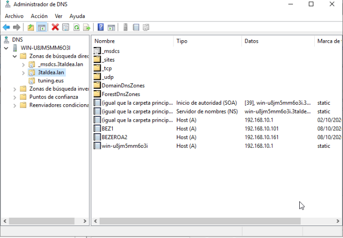

<!-- 5b. argazkia: alderantzizko eremua dagozkion PTRekin. -->
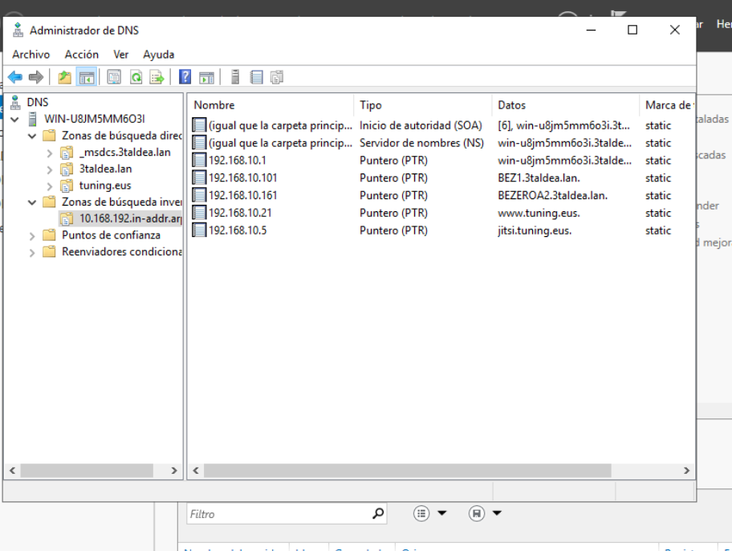

<!-- 5c. argazkia: `nslookup` izena→IP eta IP→izena ebazten. -->
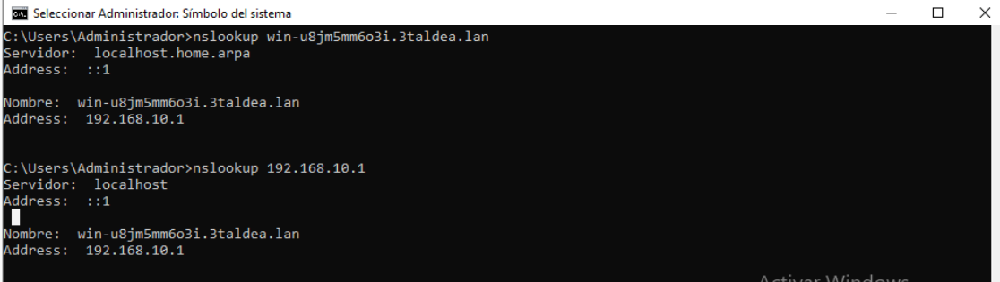


**Dokumentatu:** DNS ataka/protokoloa (**53 UDP/TCP**) eta konfigurazioa argazkiekin bat datorrela.

---

## 3. DHCP (SZI IE2)

### 3.1. Konfigurazioa

DHCP zerbitzua **Windows Serverren** dago (ez pfSensen; haren LAN DHCP desaktibatuta dago). Eremua: **`DHCP_tunning`**.

```
Eremua:        DHCP_tunning
Tartea:        192.168.10.51 – 192.168.10.250
Esklusioa:     192.168.10.51 – 192.168.10.99
Erreserba:     192.168.10.70
Aukerak:
  003 (Router):   192.168.10.254
  006 (DNS):      192.168.10.1
  015 (Domeinua): 3taldea.lan
```

### 3.2. Justifikazioa (konfigurazio aurreratua)

- **Kokapen optimoa:** DHCP zerbitzaria DNS eta AD-ren makina berean dago (`192.168.10.1`), kudeaketa zentralizatuz. pfSenseren DHCP desaktibatu da bi zerbitzarik IP berak ez banatzeko (gatazka saihestuz).
- **Esklusioa (`.51–.99`):** tarte hori IP finkoentzat gordeta dago (zerbitzariak, inprimagailuak), DHCPk ez ditzan banatu.
- **Erreserba (`.70`):** gailu jakin batek beti IP bera jaso dezan.
- **Aukerak (003/006/015):** bezeroek automatikoki jasotzen dituzte atebidea, DNSa eta domeinu-sufixoa.

### 3.3. Egiaztapena

```cmd
ipconfig /all
```
Bezeroak tarteko IP bat (`192.168.10.51–250`), DNS zuzena eta atebide zuzena jaso behar ditu. Adibidez, `BEZEROA2` makinak `192.168.10.161` jasotzen du DHCP bidez.

<!-- 6a. argazkia: eremua tartearekin, esklusioarekin eta aukerekin (003/006/015). -->
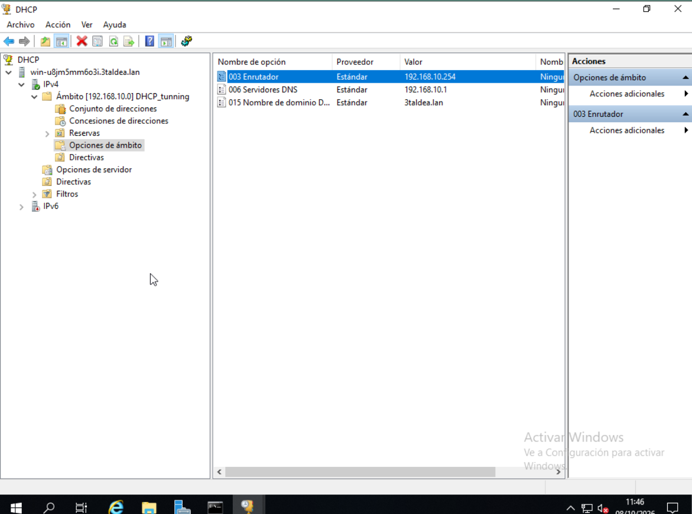
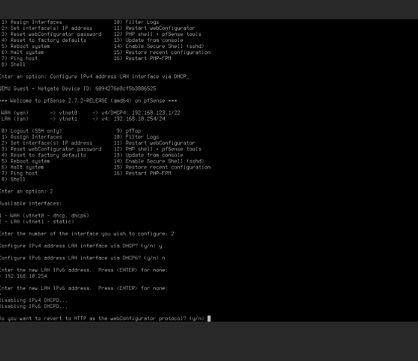

<!-- 6b. argazkia: erreserba. -->
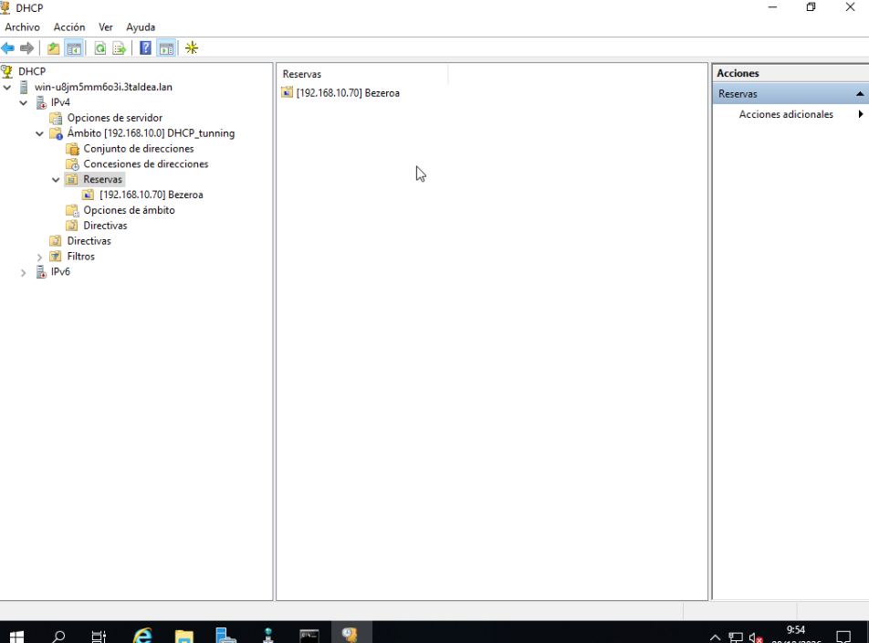

<!-- 6c. argazkia: bezeroaren `ipconfig /all` DHCP bidezko IP zuzenarekin. -->
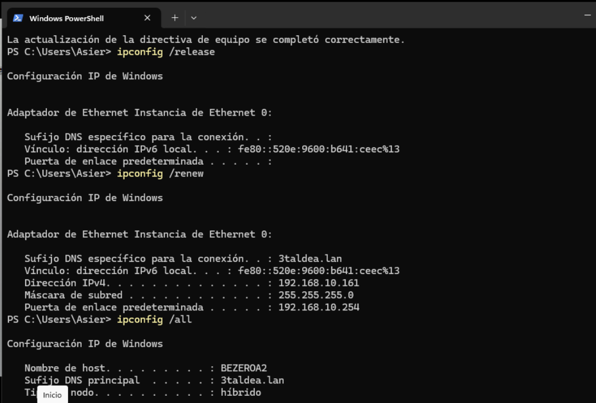
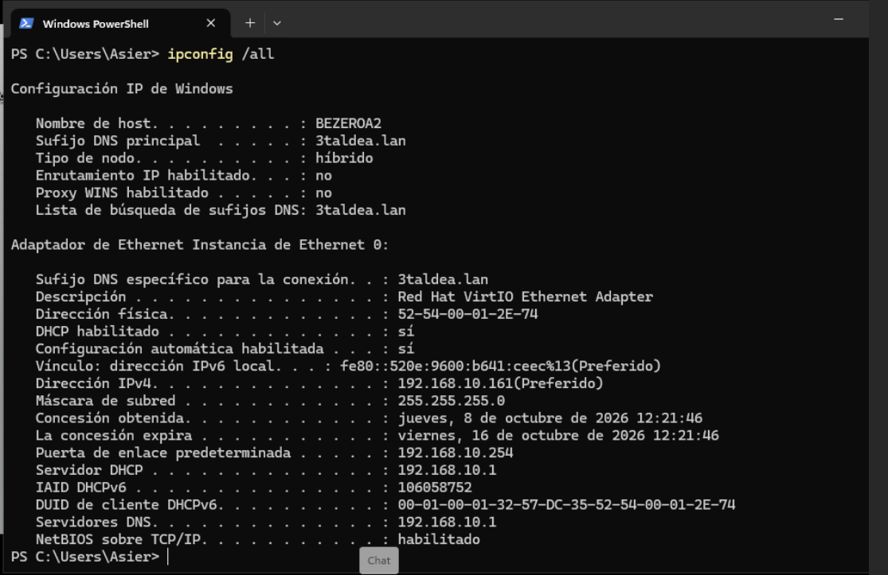


**Dokumentatu:** DHCP atakak (**67/68 UDP**) eta kokapenaren justifikazioa (zentralizatua DCn).

---

## 4. Audioa eta bideoa — Jitsi (SZI IE7/IE8)

### 4.1. Konfigurazioa

Jitsi Meet zerbitzaria `JITSI_ERRONKA` makinan dago (Ubuntu 24.04, `192.168.10.5`):

- **URLa:** `https://jitsi.tuning.eus`
- **Ziurtagiria:** **autosinatua** (nabigatzaileak "Ez da segurua" erakusten du).
- **DNS:** `jitsi.tuning.eus` → `192.168.10.5` (ikus 2. atala).

### 4.2. Froga

Jitsik **ondo funtzionatzen du** domeinuko bi erabiltzaileren artean: `luken` eta `enol` erabiltzaileekin probatua, `proba1` salan. Audioa eta bideoa behar bezala dabiltza.

<!-- 12a. argazkia: irekitako bilera, HTTPS eta domeinua barran. -->
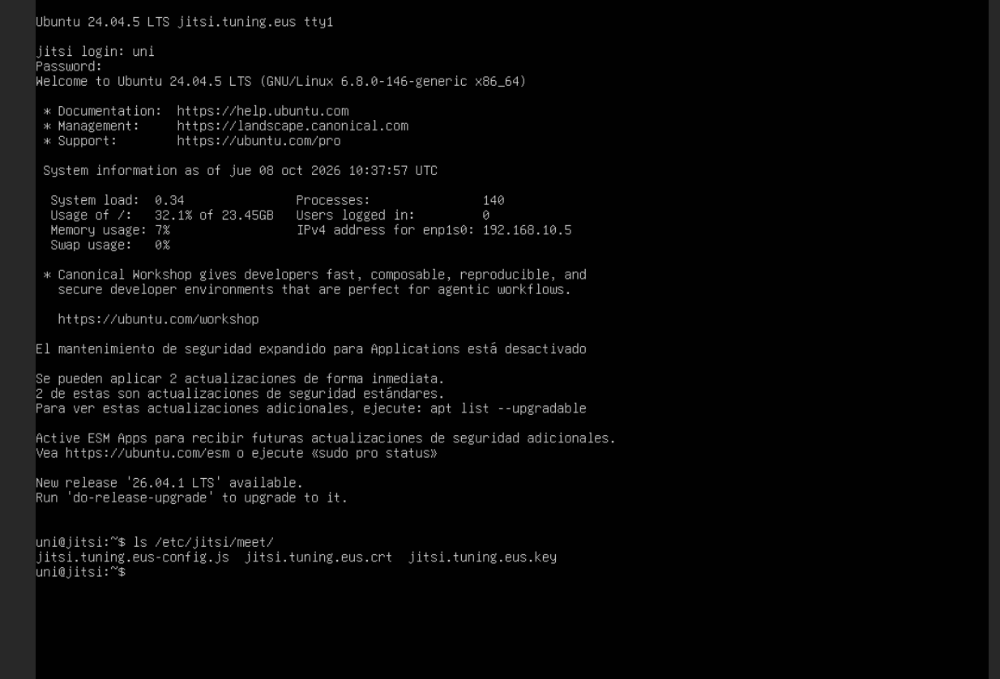
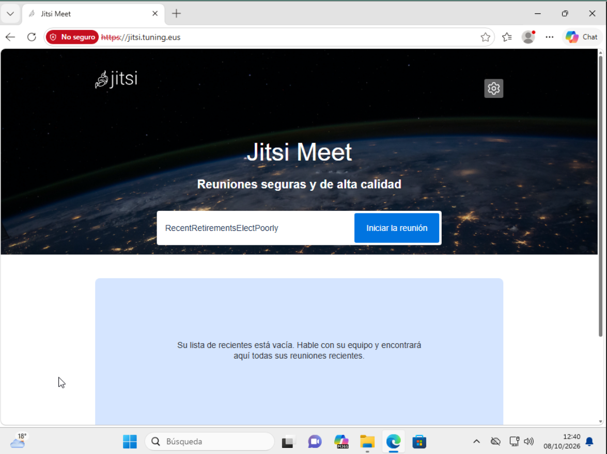

<!-- 12d. argazkia: audioa eta bideoa bi parte-hartzaileren artean funtzionatzen. -->
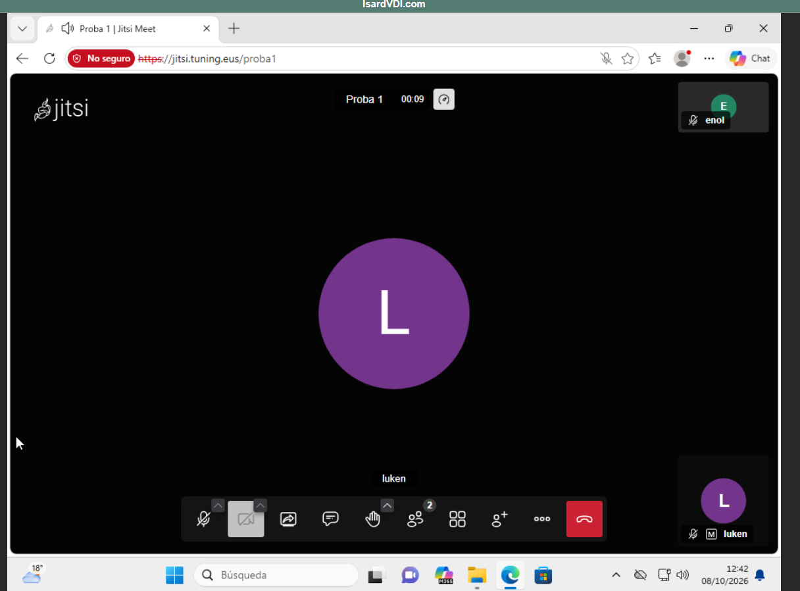


### 4.3. Atakak

Jitsi Meet-en instalazio lehenetsiak ataka hauek erabiltzen ditu; pfSensen eta Ubuntuko suebakian irekita egon behar dute:

| Ataka | Protokoloa | Zerbitzua | Erabilera |
|---|---|---|---|
| 80 | TCP | nginx | HTTP → HTTPSra birbideratzea |
| 443 | TCP | nginx | HTTPS: web-interfazea (`https://jitsi.tuning.eus`) |
| 10000 | UDP | jitsi-videobridge2 | Audio eta bideo fluxuak (RTP) |

Zerbitzarian entzuten dauden atakak egiaztatzeko:

```bash
sudo ss -tulpn | grep -E ':(80|443|10000)\b'
```

### 4.4. Diseinu-erabakia

Erabiltzailearen erabakiz, Jitsi **autentifikaziorik gabe** eta **parametroak aldatu gabe** utzi da, oinarrizko instalazioa egonkor mantentzeko.

> **Oharra (errubrika):** SZI IE7/IE8 irizpideek konfigurazio "oso aurreratua" baloratzen dute nota gorenerako (autentifikazioa, ziurtagiri baliozkoa, grabazioa, kalitate-mugak...). Oinarrizko instalazioarekin, atal hau goreneko notaren azpitik gera daiteke. Erabaki kontziente bat da, funtzionatzen duen zerbitzua ez hausteko.

---

## 5. Laburpena — egindakoa

- [x] DNS: eremu zuzenak (`3taldea.lan`, `tuning.eus`) + alderantzizko eremua + PTRak
- [x] DNS egiaztatua (`nslookup`)
- [x] DHCP (`DHCP_tunning`): tartea, esklusioa, erreserba, aukerak
- [x] DHCP egiaztatua bezeroan (`ipconfig /all`)
- [x] Jitsi martxan, bi erabiltzaileren artean frogatua
- [x] Jitsiren atakak dokumentatuta (80, 443 TCP · 10000 UDP)
- [ ] *Erabakita ez egitea:* Jitsi autentifikazioa/parametro aurreratuak

---

*TungTunning · 3. taldea · Sare Zerbitzuak*
