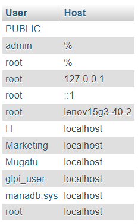
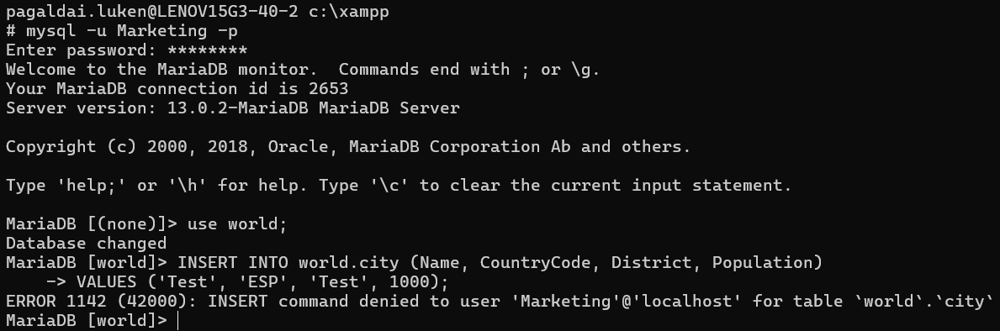
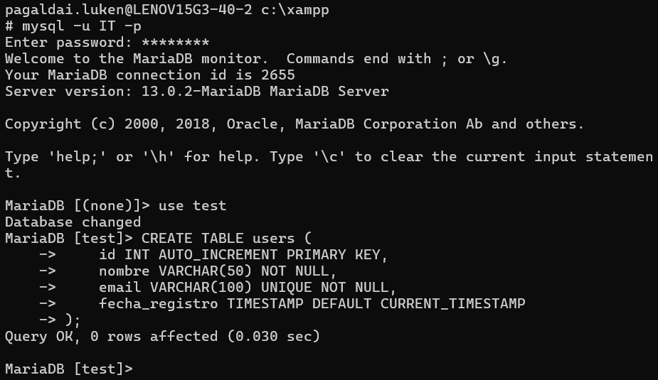
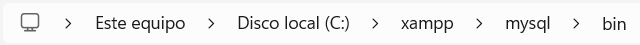
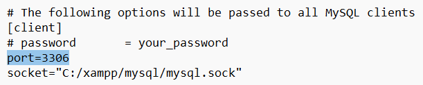
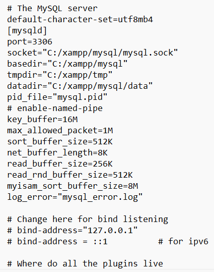
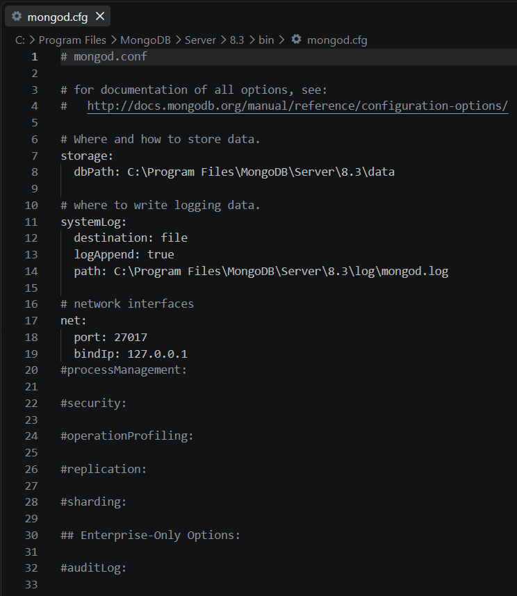

# Datu-baseak — TungTunning

> **Enpresa:** TungTunning (tuning tailerra) · **Taldea:** 3. taldea
> **Lotutako irizpideak:** DBKS — datuen analisia, DBKSaren aukeraketa, instalazioa, ustiapena, erabiltzaileak eta baimenak.
> **Araua:** egin, dokumentatu eta justifikatu; dokumentazioak benetako konfigurazioarekin bat etorri behar du.

---

## 1. Datuen analisia

Gure tailerreko informazioa bi datu-mota desberdinetan banatzen da: **erlazionala** eta **ez-erlazionala**.

**Erlazionalak (taula egituratuak):**
- **Kotxeak:** matrikula, marka, modeloa, urtea, kolorea, prezioa.
- **Ordainketak:** prezioa, ordainketa-metodoa, bezeroaren NANa, telefonoa, helbidea.
- **Langileak:** identifikazio-zenbakia, lan-txandak, NANa, telefonoa, helbidea.

**Ez-erlazionalak (egituratugabeak):**
- **Argazki eta bideoak:** kotxeen funtzionamendua azaltzen dutenak.
- **Bezeroen iritziak:** kexak, iradokizunak, etab.

Hori jakinda, **bi datu-base mota** erabiliko ditugu:

1. **MySQL/MariaDB** → datu **erlazionalak** gordetzeko.
2. **MongoDB** → datu **ez-erlazionalak** gordetzeko.

### Justifikazioa (zein datu-motatarako)

| DBKS mota | Datu-klasea | Hautatua | Zergatik |
|-----------|-------------|----------|----------|
| Erlazionala (SQL) | Egituratuak, taulak eta erlazioak | **MySQL/MariaDB** | Kotxeak, ordainketak eta langileak ondo egituratuta daude |
| Dokumentala (NoSQL) | Egituratugabeak (JSON, multimedia) | **MongoDB** | Argazkiak, bideoak eta iritziak ez dira taula-egiturakoak |

---

## 2. Erabiltzaileak eta baimenak

Enpresa lau departamentutan banatzen da (IT, administrazioa/finantzak, bezeroari arreta eta tailerra), eta langile guztiek ez dituzte baimen berak.

Guztira **bi erabiltzaile** sortu dira, bakoitza bere baimenekin:

1. **IT** — datuak **ikusteko eta eraldatzeko** baimena (irakurri + idatzi).
2. **Marketing** — datuak **ikusteko soilik** baimena (irakurri).

### Baimenen froga

**Marketing** erabiltzaileak **ezin du idatzi**: `INSERT` eragiketa ukatua ageri da (`ERROR 1142: INSERT command denied to user 'Marketing'`).

**IT** erabiltzaileak **idatzi dezake**: taula bat sortzea arrakastaz egiten du (`CREATE TABLE ... Query OK`).

---

## 3. Instalazioa

### 3.1. MySQL/MariaDB

Datu-baseak **XAMPP** bidez instalatu dira; ondorioz, MySQL/MariaDB `xampp` karpetan dago.

Ataka alda daiteke, baina kasu honetan **lehenetsia** (`3306`) erabiliko dugu.

`bind-address` bat ere gehi daiteke beste IP batzuei datu-basera sartzeko baimena emateko. Kasu honetan ez dugu ezer gehitu, **localhost** bidez sartzen garelako.

### 3.2. MongoDB

MongoDBren instalazio-karpetan aurkitzen da konfigurazio-fitxategia.

Ataka alda daiteke, baina lehenetsia erabiliko dugu. Horrez gain, sare-interfazea ere alda daiteke; guk `127.0.0.1`-ean utziko dugu, **lokaletik soilik** sartzen garelako.

---

## 4. Ustiapena eta segurtasuna

| Parametroa | Balioa |
|-----------|--------|
| Kudeaketa-interfazea | `localhost/phpmyadmin` |
| MySQL/MariaDB ataka | `127.0.0.1:3306` |
| Sare-interfazea | `127.0.0.1` (lokala soilik) |
| Sarbidea | Localhost bidez; kanpoko IPei itxita (`bind-address` gehitu gabe) |

**Segurtasun-erabakiak:**
- Datu-baseak **lokaletik soilik** atzigarriak dira (`127.0.0.1`), kanpoko erasoak saihestuz.
- Erabiltzaile bakoitzak **behar dituen baimenak** soilik ditu (IT idazteko, Marketing irakurtzeko) — pribilegio txikienaren printzipioa.
- GLPIk bere erabiltzailea (`glpi_user`) du datu-basean, aplikazioaren eta administrazioaren arteko bereizketa mantenduz.

---

## 5. Laburpena — egindakoa

- [x] Datuen analisia (erlazional vs ez-erlazional)
- [x] Bi DBKS hautatuta eta justifikatuta (MySQL/MariaDB + MongoDB)
- [x] Instalazioa dokumentatuta (XAMPP, atakak, bind-address)
- [x] Bi erabiltzaile baimen desberdinekin (IT idatzi / Marketing irakurri)
- [x] Baimenen froga (INSERT ukatua vs CREATE TABLE onartua)

---

*TungTunning · 3. taldea · Datu-baseak*
