# Sistema Eragileak — TungTunning

> **Enpresa:** TungTunning (tuning tailerra) · **Taldea:** 3. taldea
> **Lotutako irizpideak:** SEA IE1 (Active Directory, karpetak, GPO, bezeroa domeinuan), SEA IE2 (prozesuak eta zerbitzuak), SEA IE5 (inprimaketa)
> **Araua:** egin, dokumentatu eta justifikatu; dokumentazioak benetako konfigurazioarekin bat etorri behar du.

---

## 1. Sarrera eta azpiegituraren ikuspegi orokorra

TungTunning enpresak zerbitzari nagusi bat du (Windows Server 2019), domeinu baten bidez sare osoa modu zentralizatuan kudeatzen duena. Zerbitzari horrek **Active Directory (AD DS)**, **DNS**, **DHCP**, **fitxategi-zerbitzaria** eta **inprimaketa-zerbitzaria** rolak biltzen ditu. Gainerako makinak (bezeroak, CUPS zerbitzaria eta Jitsi) sare berean daude, `192.168.10.0/24` azpisarean.

Enpresak **lau sail** ditu, bakoitza bere baliabideetara mugatuta: **IT**, **Tailerra**, **Bezeroari arreta** eta **Marketina/Logistika**. IT saila da administratzailea (baliabide guztiak kudeatzen ditu); gainerako sailak erabiltzaile murriztuak dira, bakoitza bere karpetara eta inprimagailura mugatuta.

### Sarearen oinarrizko datuak (benetakoak)

```
Sarea:     192.168.10.0/24
Gateway:   192.168.10.254  (pfSense — LAN DHCP desaktibatua)
DNS:       192.168.10.1    (Windows Server)
Domeinua:  3taldea.lan
```

| Makina | SE | Hostname | IP | Funtzioa |
|--------|-----|----------|-----|----------|
| SERVER_ERRONKA | Windows Server 2019 | WIN-U8JM5MM6O3I | 192.168.10.1 | AD DS, DNS, DHCP, fitxategiak, inprimaketa |
| WINDOWS_ERRONKA_BEZ1 | Windows 11 | BEZ1 | 192.168.10.101 | Bezero Windows |
| WINDOWS_ERRONKA_BEZ2 | Windows 11 | BEZEROA2 | 192.168.10.161 (DHCP) | Bezeroa, domeinuan sartua |
| CUPS_ERRONKA | Ubuntu 20.04 | servidor | 192.168.10.67 | Inprimaketa-zerbitzaria (CUPS) |
| BEZEROA_ERRONKA_UBUNTU | Ubuntu 20.04 | servidor | 192.168.10.100 (DHCP) | Bezero Linux |
| JITSI_ERRONKA | Ubuntu 24.04 | jitsi | 192.168.10.5 | Jitsi zerbitzaria |
| pfSense SISA | pfSense | — | 192.168.10.254 | Router / suebakia |

<!-- 1. argazkia: birtualizazio-panela (IsardVDI) makina guztiekin — izena, sarea eta IPak ikusgai. -->


---

## 2. Active Directory domeinua (SEA IE1)

### 2.1. Domeinuaren instalazioa

Windows Server 2019an **AD DS** rola instalatu da eta zerbitzaria **domeinu-kontrolatzaile (DC)** gisa igo da, baso berri batean: **`3taldea.lan`**.

Domeinu-izenaren justifikazioa: `.lan` luzapena barne-sareko erabilerarako da (ez da Interneten argitaratzen), eta `3taldea` taldearen identifikatzailea da. Horrela, barne-izen guztiak domeinu horren azpian geratzen dira modu koherentean.

<!-- 2.1. argazkia: DC gisa igotako zerbitzaria, `3taldea.lan` domeinua erakutsiz. -->
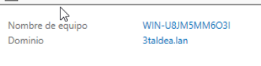


### 2.2. OU egitura, taldeak eta erabiltzaileak

OU **guraso** bat sortu da, `tunning`, eta haren barnean sail bakoitzeko OU bat. OU bakoitzak bere segurtasun-taldea eta erabiltzaileak ditu:

| OU | Segurtasun-taldea | Erabiltzailea(k) |
|----|-------------------|------------------|
| `ARRETA_taldea` | `ARRETA` | Enol |
| `IT_TALDEA` | `IT` | Asier |
| `MARKETIK_LOGISTIKA` | `MAKRKETIN_LOGISTICA` | Oier (eta beste) |
| `TAILER_TALDEA` | `TAILERRA` | Luken |

**OU egituraren justifikazioa:** sail bakoitzak bere OU izateak aukera ematen du baimenak eta GPOak sailez sail aplikatzeko, modu garbi eta mantengarrian. Erabiltzaile bakoitza bere OUan eta bere taldean dago.

**Administrazio-baimenak:** `IT` taldea **Administradores** talde lokaleko kide da (ez "Admins. del dominio"), horrela IT saileko kideek baliabideak kudeatu ahal izateko domeinu osoaren jabetza hartu gabe.

<!-- 2.2a. argazkia: OUen zuhaitza, barruan erabiltzaileak eta taldeak. -->


<!-- 2.2b. argazkia: IT erabiltzailea (Asier) `Administradores` taldearen barruan. -->
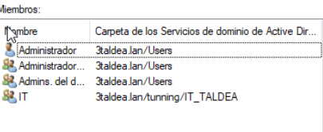


> **Hobekuntza (aukerakoa, 10erako gomendatua):** errubrikak **gutxienez bi erabiltzaile** eskatzen ditu sail bakoitzeko. Komeni da bigarren erabiltzaile bat sortzea Arreta, IT eta Tailerra sailetan.

---

## 3. Karpeta partekatuak eta baimenak (SEA IE1)

Fitxategi-zerbitzarian baliabide partekatu bat sortu da, sail bakoitzak bere karpeta pribatua izan dezan.

- **Baliabidea:** `departametuak_c` → `C:\DEPARTAMETUAK_C`
- **Azpikarpetak:** `ARRETA_C`, `IT_C`, `MARKETIN_C`, `TAILERRA_C`

**NTFS baimenak:** azpikarpeta bakoitzean, **dagokion saileko taldea** + **Administradores** soilik. Gainerako taldeei sarbidea kendu zaie (ez dute "Usuarios autenticados" sarbiderik).

| Karpeta | Sarbidea duen taldea |
|---------|----------------------|
| `ARRETA_C` | ARRETA + Administradores |
| `IT_C` | IT + Administradores |
| `MARKETIN_C` | MAKRKETIN_LOGISTICA + Administradores |
| `TAILERRA_C` | TAILERRA + Administradores |

IT saila **Administradores** taldeko kide denez, karpeta **guztietara** sartzen da; gainerako sailak beren karpetara soilik.

**Froga egina:** Tailerrako erabiltzaile batek `TAILERRA_C` soilik ikusten/atzitzen du; beste sailenak ukatuta daude.

<!-- 3a. argazkia: karpeta baten Segurtasuna (NTFS) fitxa, dagokion taldea + Administradores soilik erakutsiz. -->


<!-- 3b. argazkia: benetako froga — Tailerrako erabiltzaileak bere karpeta atzitzen du eta beste batena ukatuta ageri zaio. -->


---

## 4. Talde-politikak — GPOak (SEA IE1)

Lau GPO sortu eta estekatu dira, bakoitza bere helburu eta esparruarekin:

| GPO | Estekatua | Funtzioa |
|-----|-----------|----------|
| `fondo_pantalla` | `tunning` OU (guztiak) | Enpresaren pantaila-atzealdea ezartzea |
| `Restriccion_CMD` | ARRETA, MARKETIK, TAILER (**ez IT**) | CMD eta Erregistro-editorea blokeatzea |
| `Bloqueo_Panel_De_Control` | `TAILER_TALDEA` soilik | Kontrol-panelerako sarbidea blokeatzea |
| `imp_arreta`, `imp_marketing`, `imp_tailerra` | Sail bakoitza | Sailaren inprimagailua automatikoki zabaltzea |

**Egitura honen logika:**
- **GPO zabala** (`fondo_pantalla`): OU gurasoan estekatuta, erabiltzaile guztiei eragiten die.
- **GPO murriztaileak** (`Restriccion_CMD`, `Bloqueo_Panel_De_Control`): sail jakin batzuei soilik estekatuta. IT salbuetsita dago CMD mugatik, kudeaketa-lanak egin behar dituelako.
- **Inprimagailuen GPOak**: sail bakoitzari bere inprimagailua esleitzen diote automatikoki (ikus 7. atala).

**Froga egina:** CMD blokeatuta dago saileko erabiltzaileentzat; Asier (IT) erabiltzaileak CMD irekita dauka.

Aldaketak aplikatzeko bezeroan:
```
gpupdate /force
```

<!-- 4a. argazkia: GPMC kudeatzailea GPOekin eta haien estekekin (OUak). -->


<!-- 4b. argazkia: bezero batean — atzealdea aplikatuta eta CMD blokeatuta ("Administratzaileak desgaitu du..."). -->


---

## 5. Bezeroa domeinuan sartzea (SEA IE1)

Windows 11 bezeroak (`BEZ1`, `BEZEROA2`) domeinuan sartu dira:

1. IP zerbitzariaren tartean (DHCP bidez) eta **DNS = 192.168.10.1**.
2. Sistemaren propietateak → Aldatu → Domeinua → `3taldea.lan` → administratzaile-kredentzialak.
3. Berrabiarazi eta domeinuko erabiltzaile batekin saioa hasi.

`BEZEROA2` makina domeinuan sartuta dago eta IPa DHCP bidez jasotzen du (`192.168.10.161`).

<!-- 7a. argazkia: bezeroaren `ipconfig /all` (DNS = zerbitzaria). -->
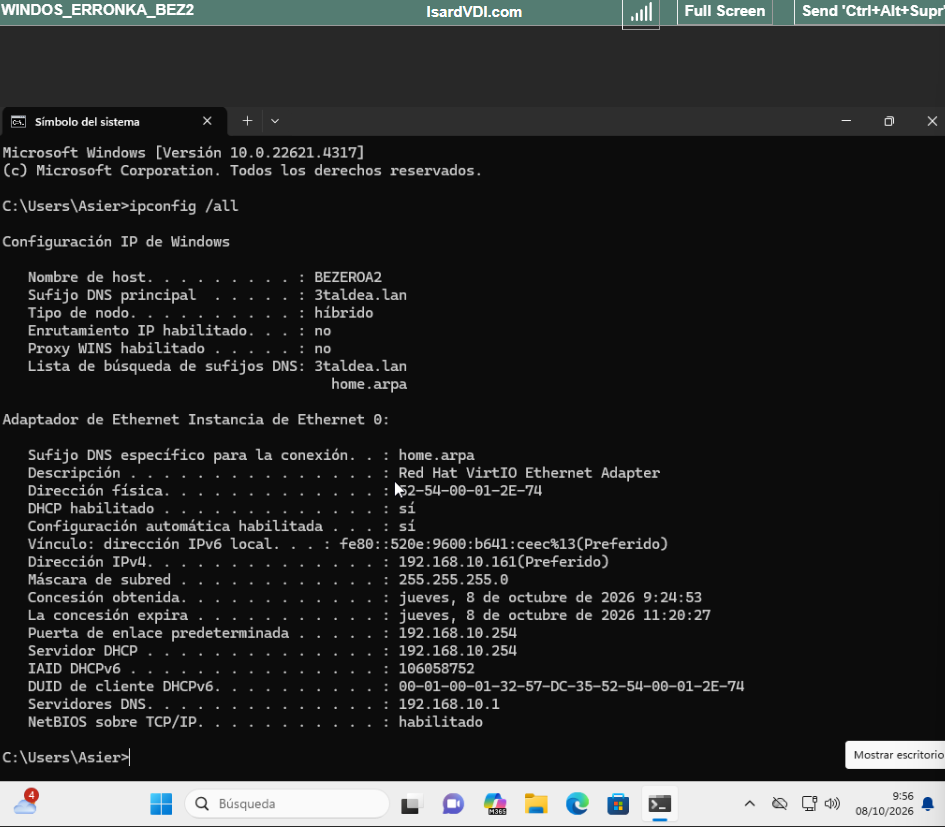

<!-- 7b. argazkia: "Ongi etorri `3taldea.lan` domeinura" pantaila. -->
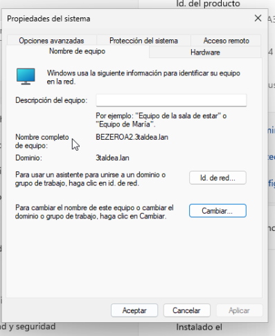

<!-- 7c. argazkia: domeinuko erabiltzaile batekin saioa hastea. -->
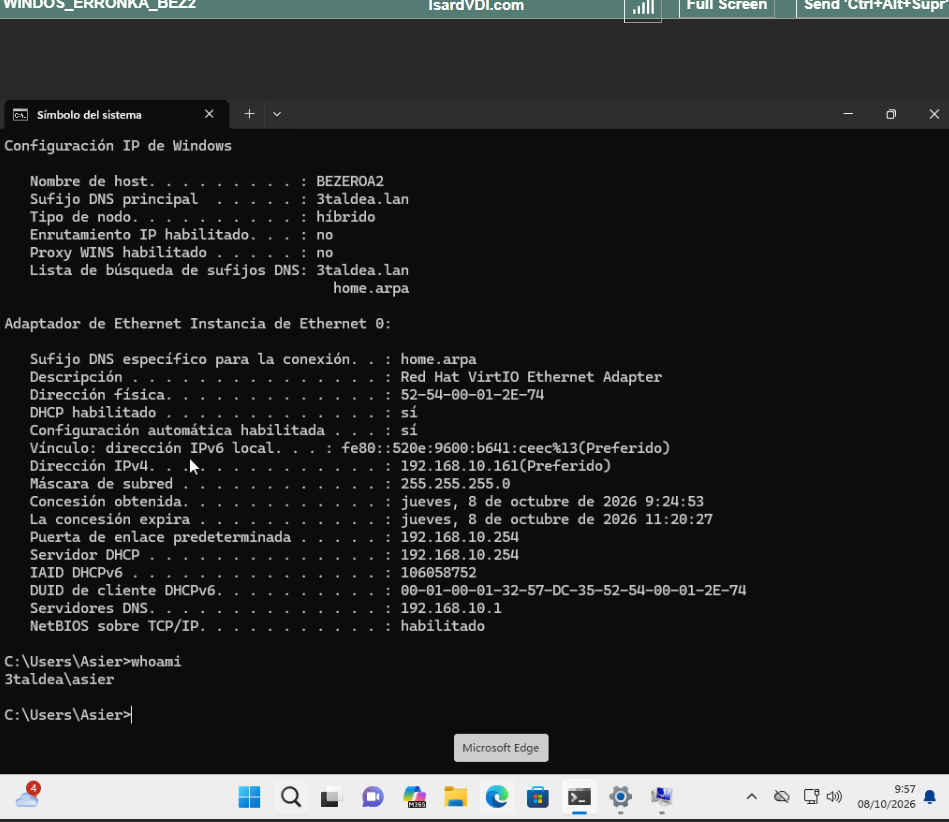


---

## 6. Prozesuak eta zerbitzuak (SEA IE2)

AD zerbitzuen eta lotutako zerbitzuen kudeaketa, **tresna grafikoekin eta komandoekin**:

```powershell
# Zerbitzuen egoera egiaztatu
Get-Service ADWS, DNS, DHCPServer, Netlogon

# Zerbitzu bat berrabiarazi
Restart-Service DNS

# Inprimaketa-zerbitzua gelditu eta abiarazi
Stop-Service Spooler ; Start-Service Spooler
```

Tresna grafikoak ere erabil daitezke: **Zeregin-administratzailea** eta **`services.msc`** zerbitzuetarako; **`tasklist`** / **`taskkill`** prozesuetarako.

<!-- 8a. argazkia: `Get-Service` AD zerbitzuak `Running` egoeran erakutsiz. -->
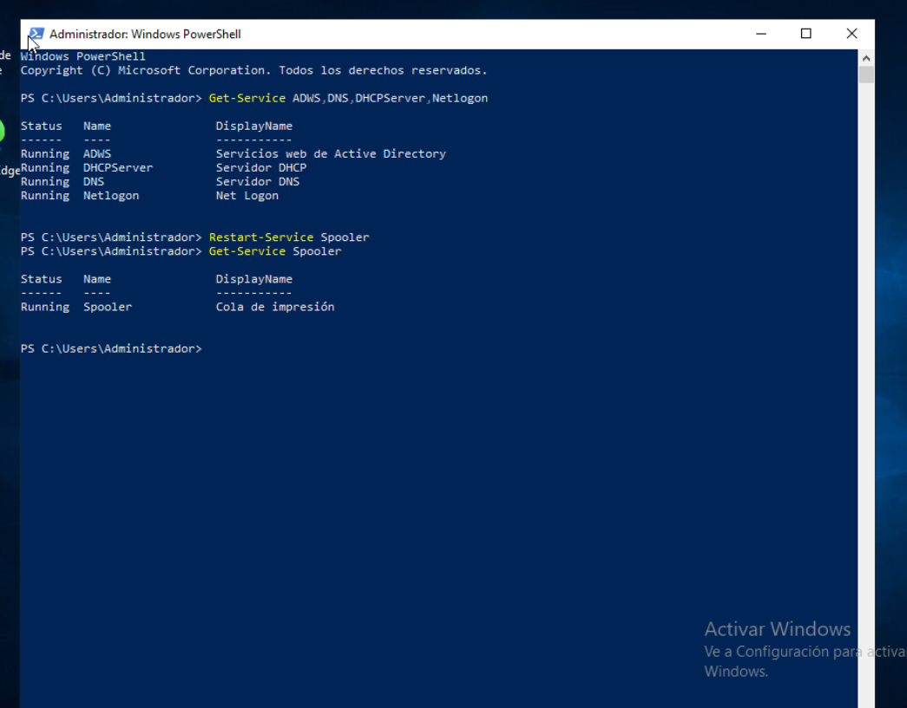

<!-- 8b. argazkia: tresna grafikoa (`services.msc` edo Zeregin-administratzailea) zerbitzu/prozesu bat kudeatzen. -->
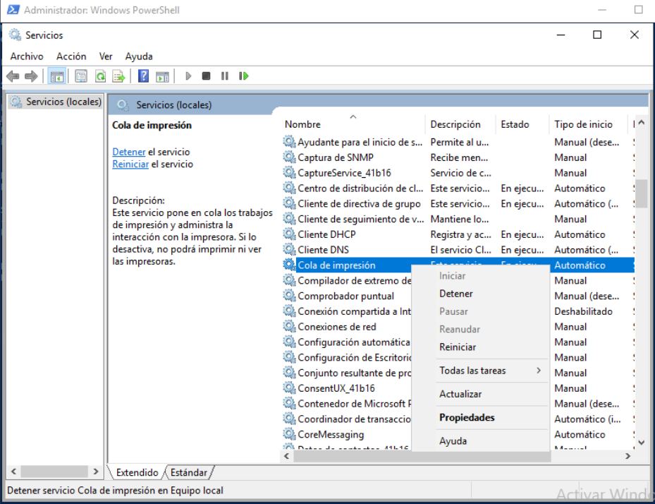


---

## 7. Inprimaketa (SEA IE5)

### 7.1. Windows Server inprimaketa

Windows Serverren **inprimaketa-rola** instalatu da eta hiru inprimagailu sortu dira (driver **Generic / Text Only**), guztiak partekatuta:

| Inprimagailua | Saila | Baimena |
|---------------|-------|---------|
| `imp_a` | Arreta | ARRETA taldeak soilik inprima dezake |
| `imp_m` | Marketina/Logistika | dagokion taldea |
| `imp_t` | Tailerra | dagokion taldea |

Inprimagailuak GPO bidez zabaltzen dira sail bakoitzera (`imp_arreta`, `imp_marketing`, `imp_tailerra`). Adibidez, **Enol**-ek `imp_a` instalatuta dauka bezeroan.

<!-- 9a. argazkia: proba-orria zerbitzaritik inprimatuta. -->


<!-- 9b. argazkia: inprimagailuaren Segurtasuna fitxa, taldekako baimenekin. -->
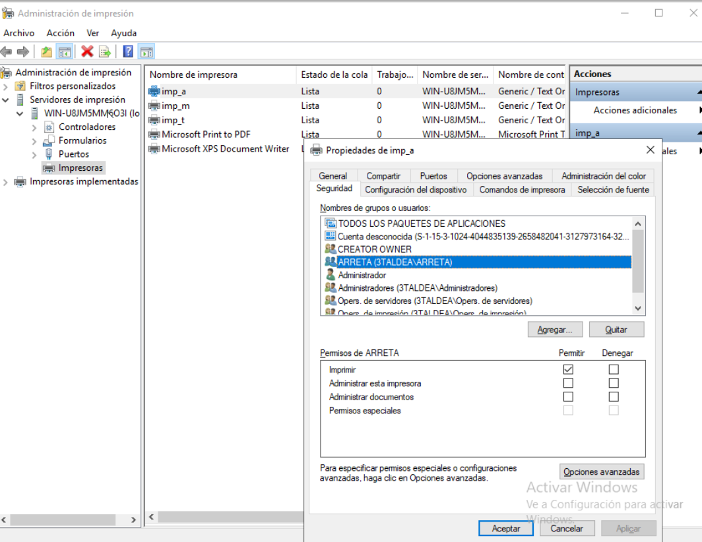

<!-- 9c. argazkia: inprimaketa zuzena domeinuko Windows bezero batetik. -->
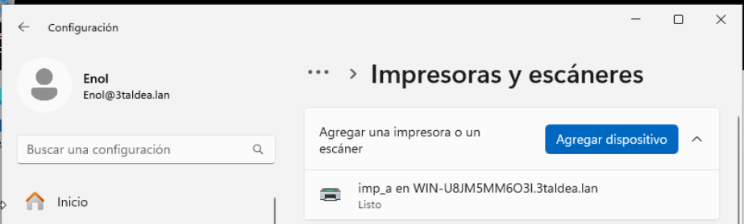


### 7.2. Linux inprimaketa — CUPS

`CUPS_ERRONKA` (Ubuntu 20.04, `192.168.10.67`) makinan **CUPS** zerbitzaria dago martxan, **631** atakan. Bi inprimagailu konfiguratuta:

- `imp_linux`
- `PDF` (cups-pdf, inprimagailu birtuala)

Biak partekatuta eta sarean argitaratuta daude. CUPS web-interfazea (`https://192.168.10.67:631`) da errubrikak aipatzen duen "web inguruneko inprimaketa-zerbitzaria".

Komando erabilgarriak:
```bash
lpstat -p -d        # inprimagailuak eta egoera
lpadmin -p ...      # gehitu/konfiguratu
lp fitxategia.pdf   # inprimatu
```

<!-- 10a. argazkia: CUPS web-interfazea (631) inprimagailuekin, "Shared: Yes". -->


<!-- 10b. argazkia: proba-orria Linuxetik bertatik. -->
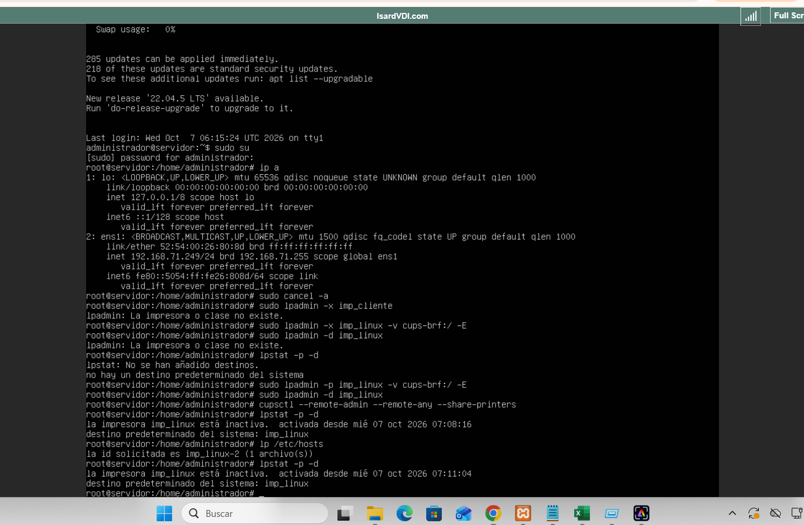

<!-- 10c. argazkia: inprimaketa zuzena sareko beste Linux batetik. -->
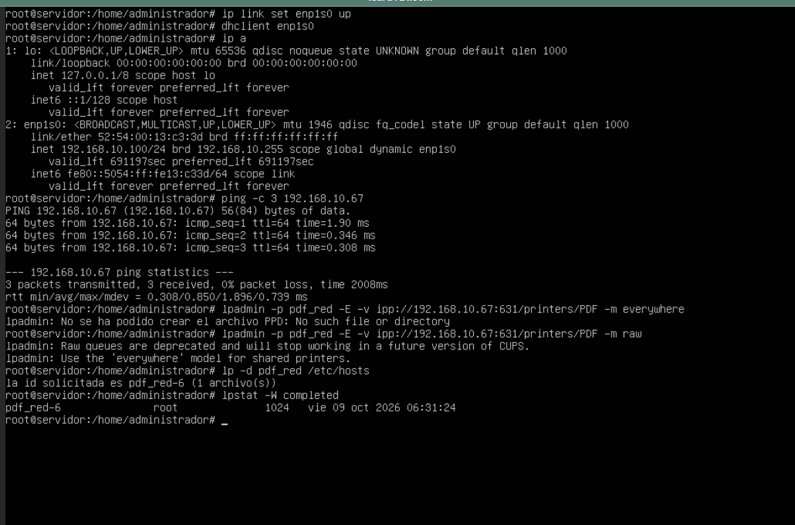


### 7.3. Inprimaketa gurutzatua

- **Linux → CUPS:** bezero Ubuntuan `pdf_red` ilara = `ipp://192.168.10.67:631/printers/PDF`. `pdf_red-6` lana osatuta.
- **Windows → Linux:** Windowsetik inprimagailua gehitu `http://192.168.10.67:631/printers/PDF` bidez. `PDF-11` lana osatuta.
- **Linux → Windows:** `imp_win` ilara = `smb://3TALDEA/Administrador:****@192.168.10.1/imp_a`. Dokumentua `imp_a` ilarara iritsi da.

<!-- 11a. argazkia: inprimaketa zuzena Windowsetik Linuxeko inprimagailuan. -->


<!-- 11b. argazkia: inprimaketa zuzena Linuxetik Windows Serverreko inprimagailuan. -->


**Dokumentatu beharrekoa (taula gisa):** inprimaketako atakak eta protokoloak Windowsen (RAW 9100, LPD 515, IPP 631 / SMB 445) eta Linuxen (IPP 631, CUPS), enpresako inprimagailuak eta kokapena, eta erabiltzaile/taldekako baimenak.

---

## 8. Laburpena — egindakoa

- [x] `3taldea.lan` domeinua eta DC
- [x] OU gurasoa (`tunning`) + sailkako OUak, taldeak eta erabiltzaileak
- [x] IT `Administradores` taldean
- [x] Karpeta partekatuak NTFS baimenekin + ukapen-froga
- [x] 4 GPO (zabala + murriztaileak + inprimagailuak), frogatuta
- [x] Bezeroak domeinuan sartuta
- [x] Prozesu/zerbitzuen kudeaketa (GUI + komandoak)
- [x] Inprimaketa Windows + CUPS + gurutzatua
- [ ] *Aukerakoa:* 2. erabiltzailea sailez sail

---

*TungTunning · 3. taldea · Sistema Eragileak*
